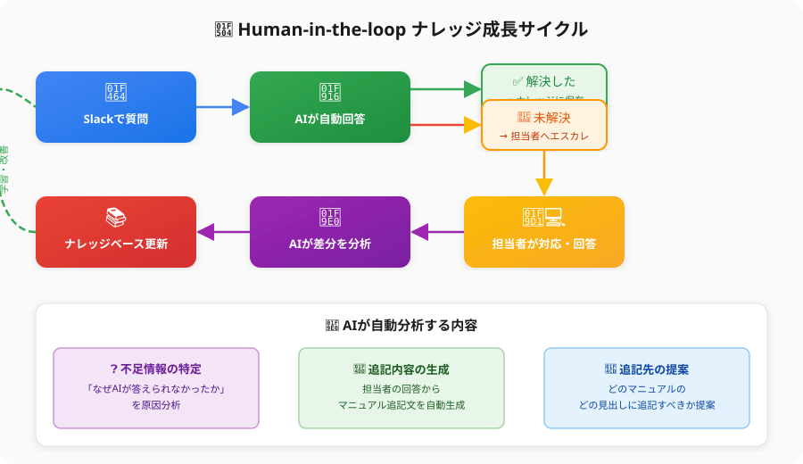
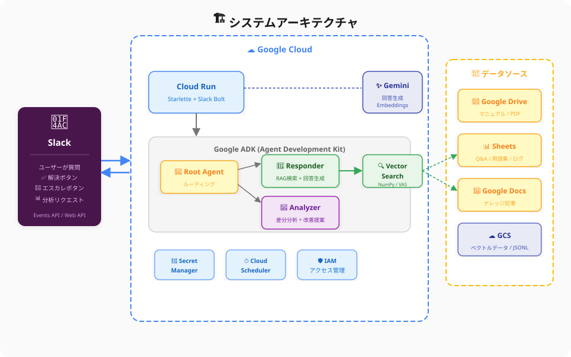

# Portfolio - Kuroda Shunya

Google Cloud を中心としたインフラ構築からWebアプリケーション開発、AIエージェント開発まで一貫して対応するエンジニアです。

## 🏆 資格・アワード
- **Google Partner Top Engineer 2025**
- **Google Cloud 認定資格 9種保有**
  - Generative AI Leader
  - Associate Cloud Engineer
  - Associate Data Practitioner
  - Professional Cloud Architect
  - Professional Cloud Security Engineer
  - Professional Security Operations Engineer
  - Professional Data Engineer
  - Professional Machine Learning Engineer
  - Professional Cloud Database Engineer

---

## 🚀 Projects

### 1. RAG Knowledge Agent - AI社内ナレッジボット

> 社内のナレッジをAIが学習し、Slack上で質問に自動回答。未解決時は担当者にエスカレーションし、その対応内容を分析してナレッジを自動拡充する「自己成長型」のAIエージェント。

#### 🎯 解決する課題
- 社内の暗黙知が属人化し、同じ質問が繰り返される
- マニュアルが分散しており、必要な情報にたどり着けない
- ナレッジの更新が追いつかず、情報が陳腐化する

#### ✨ 主要機能
- 💬 **Slack連携**: 普段使いのSlackからメンションするだけでAIが即座に回答
- 📚 **RAG (Retrieval-Augmented Generation)**: 社内ドキュメント(Google Drive, スプレッドシートなど)を検索し、ハルシネーションを抑えた正確な回答を生成
- 🧑‍💻 **Human-in-the-loop (エスカレーション)**: AIが回答できない場合は、自動で人間の担当者へエスカレーション
- 🔄 **自動ナレッジ抽出**: 担当者の回答をAIが分析し、次回の回答のためにナレッジベースを自動更新
- 📊 **利用状況ダッシュボード**: 質問の傾向や解決率を可視化し、ナレッジの抜け漏れを特定
- 🔐 **セキュアなアクセス制御**: ユーザーの権限に応じた情報へのアクセス制限

#### 🔄 Human-in-the-loop ナレッジ成長サイクル

#### 🏗️ システムアーキテクチャ

#### 🛠️ 使用技術

| カテゴリ | 技術スタック |
| :--- | :--- |
| **Cloud** | Google Cloud (Cloud Run, Cloud Scheduler, IAM, Secret Manager) |
| **Backend** | Python, Starlette, Slack Bolt for Python |
| **AI / ML** | Google ADK (Agent Development Kit), Gemini API, Gemini Embeddings |
| **Vector Search** | NumPy (ローカルベクトル検索) / Vertex AI Search (Discovery Engine) |
| **Data Sources** | Google Workspace APIs (Drive, Sheets, Docs) |

#### 📹 デモ
> ※ デモ動画・スクリーンショットは準備中です

<!-- Placeholder for future demo content -->
<!--  -->
<!--  -->

#### 🔗 関連リンク
- [汎用テンプレート版（Public）](https://github.com/Kuroda-Shunya/rag-agent-template)

---

### 2. Coming Soon...
> 今後、追加のプロジェクトを掲載予定です。

---

## 📬 Contact
- GitHub: [@Kuroda-Shunya](https://github.com/Kuroda-Shunya)
